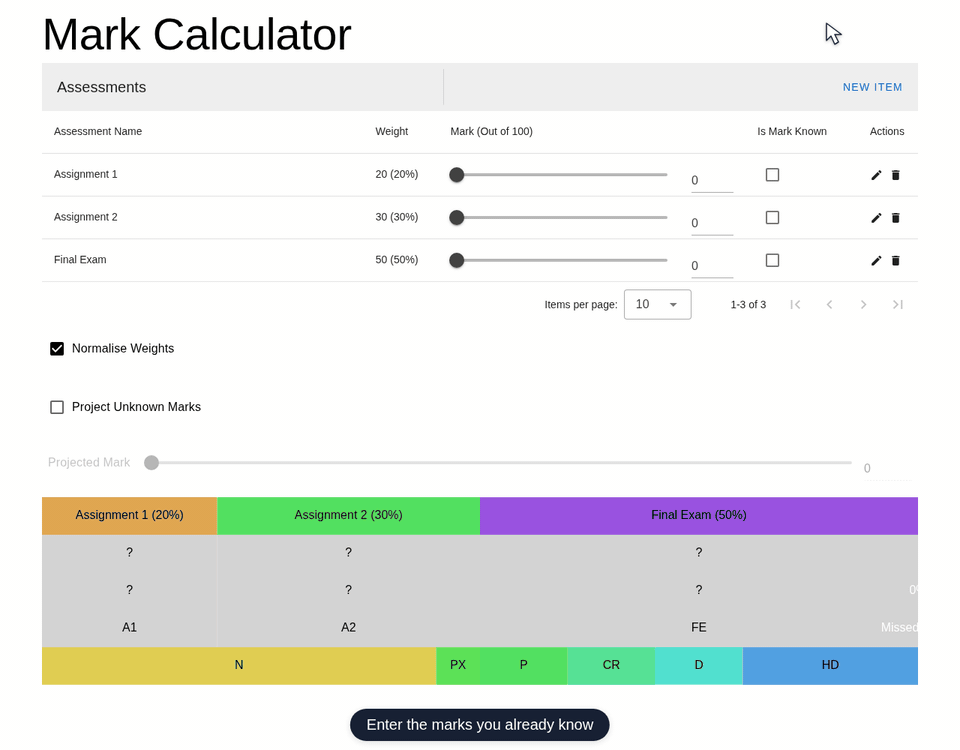

# Mark Calculator

Estimate and visualise your overall course mark from weighted assessments. Built with Vue 3, TypeScript, Vuetify 3 and Tailwind CSS, with Vite for development and production builds.



[View a static screenshot](public/screenshot.png).

## Using the calculator

- Add, edit or remove assessments and set each assessment's weight and mark out of 100.
- Tick **Is Mark Known** for results you already have.
- Leave **Normalise Weights** enabled to scale weights to a total of 100%. Disable it when weights already represent percentages of the course.
- Enable **Project Unknown Marks** and adjust the projected mark to explore possible outcomes for unfinished assessments.
- The diagram shows assessment weights, individual marks, contributions to the total, missed marks and grade boundaries.

The default boundaries are Fail (0), Supplemental Pass (45), Pass (50), Credit (60), Distinction (70) and High Distinction (80). Adjust these in `src/App.vue` if your institution uses a different scale.

All calculations run in your browser. There is no backend, account or database, and refreshing the page resets the assessments.

## Local development

Use **Node.js 24** and npm. If you use nvm, run `nvm install` and `nvm use` to select the version in `.nvmrc`.

```sh
npm ci
npm run dev
```

Open the URL Vite prints (usually <http://localhost:5173>). No environment variables or external services are required. Icons are bundled locally.

```sh
npm run lint       # ESLint checks for Vue, TypeScript and configuration files
npm run typecheck  # Check Vue components and Vite configuration
npm run build      # Type checking and production build into dist/
npm run preview    # Preview dist/ locally, usually on port 4173
npm audit          # Check the locked dependencies against npm advisories
```

Serve `dist/` from a static web server for production. Vite's development and preview servers are for local use. The default build expects to be hosted at the root of a domain; set Vite's `base` option for a subpath deployment and adapt the web server configuration accordingly.

The toolchain uses Vite 8, Tailwind 4 and ESLint's flat configuration. TypeScript stays on the 6.0 line supported by the lint tooling, and Vuetify stays on version 3 to preserve the existing UI.

## Docker

The multi-stage Dockerfile builds the app with Node.js 24 and serves the static files using unprivileged NGINX on port 8080. The runtime needs only a writable `/tmp`; it runs as UID/GID 101, with a `/healthz` endpoint and a Docker health check.

```sh
docker compose up --build -d
# Open http://localhost:8080
docker compose down
```

Or build and run directly:

```sh
docker build -t mark-calculator:local .
docker run --rm -p 8080:8080 --read-only \
  --tmpfs /tmp:rw,noexec,nosuid,size=16m,mode=1777 \
  --cap-drop ALL --security-opt no-new-privileges:true \
  mark-calculator:local
```

`deploy/nginx.conf` configures health checks, SPA fallback, caching for built assets and revalidation of the HTML entry point. Terminate HTTPS at your reverse proxy or ingress.

## GitHub Actions and GHCR

[The container workflow](.github/workflows/container.yaml) installs locked dependencies, runs linting, type checks, a production build and an npm audit, then builds and smoke-tests the container with a read-only filesystem.

- **Pull requests:** validate and build the container without publishing.
- **Pushes to `main`:** publish `linux/amd64` and `linux/arm64` images to `ghcr.io/ashleylamont/mark-calculator` with `latest`, `main` and `sha-<full commit SHA>` tags.
- **Version tags**, such as `v1.2.3`: publish `1.2.3`, `1.2` and the commit tag. Version releases do not change `latest`.
- **Manual runs:** available through `workflow_dispatch`; publishing is limited to `main` and version tag refs.

The workflow derives the image name from the repository, so forks use their own GHCR path. It authenticates with the built-in `GITHUB_TOKEN` using `packages: write`; no personal access token is needed. Enable GitHub Actions and allow package publishing in the repository or organisation settings. After the first publish, make the GHCR package public for anonymous pulls, or configure registry credentials in your deployment.

```sh
docker run --rm -p 8080:8080 ghcr.io/ashleylamont/mark-calculator:latest
```

These files configure publishing; an image is first published when the workflow runs on GitHub.

## Kubernetes

`k8s/` contains a Kustomize configuration with a two-replica Deployment and a ClusterIP Service. Pods run as non-root with a read-only root filesystem, dropped capabilities, resource requests/limits, a temporary volume and HTTP readiness/liveness probes.

After publishing an image, select its tag in `k8s/kustomization.yaml`. The example defaults to `latest`; for repeatable deployments, replace `newTag` with a release tag or `sha-<full commit SHA>`. If using a fork, also change the image repository in the manifests and Kustomize image entry. Private GHCR packages require an `imagePullSecrets` entry in the pod spec referencing a registry secret in the same namespace.

```sh
kubectl kustomize k8s/                  # Inspect the rendered manifests
kubectl apply -k k8s/ -n YOUR_NAMESPACE # Use an existing namespace
kubectl rollout status deployment/mark-calculator -n YOUR_NAMESPACE
kubectl port-forward service/mark-calculator 8080:80 -n YOUR_NAMESPACE
# Open http://localhost:8080
```

For public access, point your existing ingress or reverse proxy at the `mark-calculator` Service on port 80 and configure your hostname and TLS there. No persistent storage or application secrets are required.
